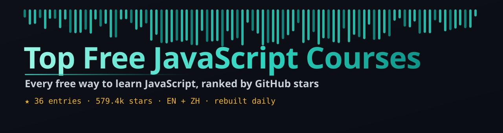

# Top Free JavaScript Courses

<i>Every free way to learn JavaScript, ranked by GitHub stars</i>

  

  

**English** · [简体中文](README.zh-CN.md)

---

## Contents

- [🏆 Top Picks](#top-picks)
- [Books & Guides](#sec-1) · 12
- [Practice & Interviews](#sec-2) · 12
- [Courses & Tutorials](#sec-3) · 12
- [📖 About this list](#about)

## 🏆 Top Picks

| # | Project | ⭐ Stars | Language | Updated | Description |
|:-:|:--|--:|:-:|:-:|:--|
| 1 | [**getify/You-Dont-Know-JS**](https://github.com/getify/You-Dont-Know-JS) | 184.8k | — | 2026-02-15 | A book series (2 published editions) on the JS language. |
| 2 | [**sudheerj/reactjs-interview-questions**](https://github.com/sudheerj/reactjs-interview-questions) | 44.9k | JavaScript | 2026-10-13 | List of top 500 ReactJS Interview Questions & Answers....Coding exercise questions are coming soon!! |
| 3 | [**yangshun/front-end-interview-handbook**](https://github.com/yangshun/front-end-interview-handbook) | 44.0k | JavaScript | 2026-10-05 | Front End interview preparation materials for busy engineers (updated for 2026) |
| 4 | [**denysdovhan/wtfjs**](https://github.com/denysdovhan/wtfjs) | 37.7k | JavaScript | 2026-10-05 | 🤪 A list of funny and tricky JavaScript examples |
| 5 | [**haizlin/fe-interview**](https://github.com/haizlin/fe-interview) | 26.3k | JavaScript | 2025-10-26 | Chinese-language project; see the repo for details |

## Books & Guides

| # | Project | ⭐ Stars | Language | Updated | Description |
|:-:|:--|--:|:-:|:-:|:--|
| 1 | [**getify/You-Dont-Know-JS**](https://github.com/getify/You-Dont-Know-JS) | 184.8k | — | 2026-02-15 | A book series (2 published editions) on the JS language. |
| 2 | [**denysdovhan/wtfjs**](https://github.com/denysdovhan/wtfjs) | 37.7k | JavaScript | 2026-10-05 | 🤪 A list of funny and tricky JavaScript examples |
| 3 | [**getify/Functional-Light-JS**](https://github.com/getify/Functional-Light-JS) | 16.7k | JavaScript | 2023-12-26 | Pragmatic, balanced FP in JavaScript. @FLJSBook on twitter. |
| 4 | [**gibbok/typescript-book**](https://github.com/gibbok/typescript-book) | 10.4k | TypeScript | 2026-10-23 | The Concise TypeScript Book: A Concise Guide to Effective Development in TypeScript. Free and Open Source. |
| 5 | [**azat-io/you-dont-know-js-ru**](https://github.com/azat-io/you-dont-know-js-ru) | 8.8k | — | 2026-06-06 | 📚 Russian translation of "You Don't Know JS" book series |
| 6 | [**thejsway/thejsway**](https://github.com/thejsway/thejsway) | 7.9k | CSS | 2025-01-30 | The JavaScript Way book |
| 7 | [**amejiarosario/dsa.js-data-structures-algorithms-javascript**](https://github.com/amejiarosario/dsa.js-data-structures-algorithms-javascript) | 7.8k | JavaScript | 2024-01-30 | 🥞Data Structures and Algorithms explained and implemented in JavaScript + eBook |
| 8 | [**nao-sabemos-js/You-Dont-Know-JS**](https://github.com/nao-sabemos-js/You-Dont-Know-JS) | 5.9k | JavaScript | 2026-06-15 | 📗📒 (PT-Br translation) JS Book Series. |
| 9 | [**doodlewind/jshistory-cn**](https://github.com/doodlewind/jshistory-cn) | 4.2k | TypeScript | 2022-08-24 | Chinese-language project; see the repo for details |
| 10 | [**FrontendMasters/front-end-handbook-2019**](https://github.com/FrontendMasters/front-end-handbook-2019) | 4.1k | HTML | 2023-07-26 | [Book] 2019 edition of our front-end development handbook |

Show 2 more

| # | Project | ⭐ Stars | Language | Updated | Description |
|:-:|:--|--:|:-:|:-:|:--|
| 11 | [**mjavascript/mastering-modular-javascript**](https://github.com/mjavascript/mastering-modular-javascript) | 4.0k | HTML | 2020-10-14 | 📦 Module thinking, principles, design patterns and best practices. |
| 12 | [**mjavascript/practical-modern-javascript**](https://github.com/mjavascript/practical-modern-javascript) | 3.1k | XSLT | 2023-08-17 | 🏊 Dive into ES6 and the future of JavaScript |

## Practice & Interviews

| # | Project | ⭐ Stars | Language | Updated | Description |
|:-:|:--|--:|:-:|:-:|:--|
| 1 | [**sudheerj/reactjs-interview-questions**](https://github.com/sudheerj/reactjs-interview-questions) | 44.9k | JavaScript | 2026-10-13 | List of top 500 ReactJS Interview Questions & Answers....Coding exercise questions are coming soon!! |
| 2 | [**yangshun/front-end-interview-handbook**](https://github.com/yangshun/front-end-interview-handbook) | 44.0k | JavaScript | 2026-10-05 | Front End interview preparation materials for busy engineers (updated for 2026) |
| 3 | [**haizlin/fe-interview**](https://github.com/haizlin/fe-interview) | 26.3k | JavaScript | 2025-10-26 | Chinese-language project; see the repo for details |
| 4 | [**lgwebdream/FE-Interview**](https://github.com/lgwebdream/FE-Interview) | 7.2k | JavaScript | 2023-01-06 | Chinese-language project; see the repo for details |
| 5 | [**ganqqwerty/123-Essential-JavaScript-Interview-Questions**](https://github.com/ganqqwerty/123-Essential-JavaScript-Interview-Questions) | 5.2k | — | 2024-06-28 | JavaScript interview Questions |
| 6 | [**YauhenKavalchuk/interview-questions**](https://github.com/YauhenKavalchuk/interview-questions) | 4.6k | — | 2026-10-19 | Популярные HTML / CSS / JavaScript / ECMAScript / TypeScript / React / Vue / Angular / Node вопросы на интерв… |
| 7 | [**sadanandpai/javascript-code-challenges**](https://github.com/sadanandpai/javascript-code-challenges) | 4.5k | MDX | 2026-04-01 | A collection of JavaScript modern interview code challenges for beginners to experts |
| 8 | [**rohan-paul/Awesome-JavaScript-Interviews**](https://github.com/rohan-paul/Awesome-JavaScript-Interviews) | 3.7k | JavaScript | 2024-02-29 | Popular JavaScript / React / Node / Mongo stack Interview questions and their answers. Many of them, I faced… |
| 9 | [**baeharam/Must-Know-About-Frontend**](https://github.com/baeharam/Must-Know-About-Frontend) | 3.7k | — | 2024-03-16 | Chinese-language project; see the repo for details |
| 10 | [**kennymkchan/interview-questions-in-javascript**](https://github.com/kennymkchan/interview-questions-in-javascript) | 3.6k | — | 2019-09-30 | A mostly reasonable collection of technical software development interview questions solved in Javascript |

Show 2 more

| # | Project | ⭐ Stars | Language | Updated | Description |
|:-:|:--|--:|:-:|:-:|:--|
| 11 | [**alexgurr/react-coding-challenges**](https://github.com/alexgurr/react-coding-challenges) | 3.4k | SCSS | 2023-09-05 | A series of ReactJS coding challenges with a variety of difficulties. |
| 12 | [**khan4019/front-end-Interview-Questions**](https://github.com/khan4019/front-end-Interview-Questions) | 3.1k | HTML | 2024-05-26 | Help the front End community to rock interview |

## Courses & Tutorials

| # | Project | ⭐ Stars | Language | Updated | Description |
|:-:|:--|--:|:-:|:-:|:--|
| 1 | [**javascript-tutorial/en.javascript.info**](https://github.com/javascript-tutorial/en.javascript.info) | 25.5k | HTML | 2026-07-25 | Modern JavaScript Tutorial |
| 2 | [**MostlyAdequate/mostly-adequate-guide**](https://github.com/MostlyAdequate/mostly-adequate-guide) | 23.8k | JavaScript | 2024-09-17 | Mostly adequate guide to FP (in javascript) |
| 3 | [**verekia/js-stack-from-scratch**](https://github.com/verekia/js-stack-from-scratch) | 20.1k | JavaScript | 2024-06-05 | 🛠️⚡ Step-by-step tutorial to build a modern JavaScript stack. |
| 4 | [**nswbmw/N-blog**](https://github.com/nswbmw/N-blog) | 15.4k | JavaScript | 2023-04-26 | Chinese-language project; see the repo for details |
| 5 | [**javascript-tutorial/zh.javascript.info**](https://github.com/javascript-tutorial/zh.javascript.info) | 10.8k | HTML | 2026-03-24 | Chinese-language project; see the repo for details |
| 6 | [**xcatliu/typescript-tutorial**](https://github.com/xcatliu/typescript-tutorial) | 10.7k | TypeScript | 2024-08-18 | Chinese-language project; see the repo for details |
| 7 | [**mouredev/hello-javascript**](https://github.com/mouredev/hello-javascript) | 8.4k | JavaScript | 2025-06-10 | Curso para aprender el lenguaje de programación JavaScript desde cero y para principiantes. +120 lecciones, 1… |
| 8 | [**javascript-tutorial/ru.javascript.info**](https://github.com/javascript-tutorial/ru.javascript.info) | 4.1k | HTML | 2026-10-19 | Современный учебник JavaScript |
| 9 | [**tyroprogrammer/learn-react-app**](https://github.com/tyroprogrammer/learn-react-app) | 3.8k | JavaScript | 2026-02-04 | Application that will help you learn React fundamentals. Install this application locally - there's tutorial,… |
| 10 | [**js-primer/js-primer**](https://github.com/js-primer/js-primer) | 2.4k | JavaScript | 2026-10-21 | Chinese-language project; see the repo for details |

Show 2 more

| # | Project | ⭐ Stars | Language | Updated | Description |
|:-:|:--|--:|:-:|:-:|:--|
| 11 | [**survivejs/webpack-book**](https://github.com/survivejs/webpack-book) | 2.4k | JavaScript | 2026-02-02 | From apprentice to master (CC BY-NC-ND) |
| 12 | [**ErickWendel/semana-javascript-expert07**](https://github.com/ErickWendel/semana-javascript-expert07) | 2.4k | JavaScript | 2023-12-12 | JS Expert Week 7.0 - 🙅🤏🏻 Controlling Streaming Platforms using Eye and Hand Detection 👁🖐 |

## 📖 About this list

This list is collected from GitHub, deduplicated, link-checked and ranked by stars (recency breaks ties). It is regenerated automatically on a schedule, so numbers stay fresh.

---

Auto-generated · refreshed on a schedule · ranked by GitHub stars · 2026-10-24

